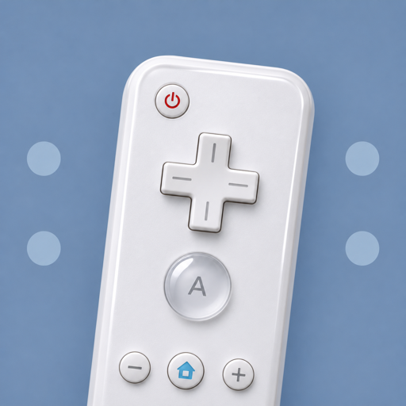

# MSB Wiimote Mouse

> **Provided for historical purposes.** This is the code as it was used between 2008 and 2010, kept for reference and research. It is not maintained, no binary is provided, and it hasn't been run on current Windows or hardware.

Lets a Wii Remote aim across several sensor bars, so one controller can cover a wide, surround display. The Wiimote and Nunchuk drive the Windows mouse and keyboard, with every control mapped in a script.

It was written in 2007–2008 for an honours project at the Australian National University that ran Half-Life 2 in the Wedge, a two-walled virtual reality theatre, with five sensor bars spread around its screens. The approach and its user testing are described in [The Wiimote with multiple sensor bars](https://doi.org/10.1145/1577782.1577790) (Sko and Gardner, CHINZ 2009).

## How it works

The Wiimote's IR camera reports at most four points, so it can see two sensor bars at a time. The program is given the layout of every bar on the display and keeps a model of which of them are in view:

- Visible dots are tracked between reports. A dot that appears, or jumps more than half the camera's view, is treated as a new dot.
- Dots are grouped into bars by proximity, closest pairs first.
- Each new grouping is merged with the previous one through the dots the two have in common. When dots appear at one edge of the camera's view, the model shifts a bar along, so the Wiimote hops from bar to bar as you turn.
- The visible dots are matched to their known screen positions and the cursor is placed from those matches, using a scale learnt from the dot spacing or fixed in the configuration.

If the model can't reconcile what the camera sees, it resets on the assumption that you are pointing at the centre bar, and the Wiimote gives a long rumble. Pointing off the end of the array gives a short rumble. A recenter action, normally mapped to a button, shifts the model back to the centre bar when it has drifted.

Bars should be mounted vertically, so that neighbouring bars are told apart by their horizontal spacing.

## Requirements

- Windows, with a Bluetooth adapter that pairs with a Wiimote
- A Wii Remote, optionally with a Nunchuk
- IR sensor bars (a pair of IR LEDs each), mounted vertically

## Building

No binary is provided. The solution is a Visual Studio 2005 C# project targeting .NET Framework 2.0. Open `Wiimote.sln` in a current Visual Studio, accept the project upgrade, and build `WiimoteMouse`.

As of November 2026 the sources compile unchanged against .NET Framework 4.8. The application itself hasn't been run since 2010.

## Using it

The application runs in the system tray. From its menu:

1. **Load IR Configuration** describes your sensor bar layout. [`configs/IR.txt`](configs/IR.txt) documents the format, and [`configs/IRWedge.txt`](configs/IRWedge.txt) is the five-bar layout used in the Wedge.
2. **Load Button Configuration** maps Wiimote and Nunchuk buttons, the joystick, flicks and sustained motions to key presses, mouse clicks, the scroll wheel or the recenter action. [`configs/Buttons.txt`](configs/Buttons.txt) documents the format; the others are the mappings used for Half-Life 2.

**Show Status** opens a window that draws the camera's dots, the current grouping and the model as it tracks. **Save Scale** appends the learnt scale to the loaded IR configuration so it no longer has to be learnt each session.

## Repository layout

- `WiimoteMouse/` is the application. The tracking model lives in `MainForm.cs`, button and motion scripting in `MotionAndButtonController.cs`.
- `WiimoteLib/` is Brian Peek's [Managed Library for Nintendo's Wiimote](https://github.com/BrianPeek/WiimoteLib) v1.1, with one functional change: a failed copy of a read reply, seen when rumble and the Nunchuk were used together, is dropped rather than raised.
- `WiimoteTest/` is the test application that ships with WiimoteLib, useful for checking a Wiimote connects.
- `configs/` holds the sample IR and button configurations.

## Known issues

- Dots are grouped in screen pixels, so the layout's proportions are stretched to the primary screen's. On a screen much narrower than the layout, neighbouring bars can end up closer than the two dots of one bar and be paired wrongly. `IRWedge.txt` suits a wide, multi-projector desktop.
- The model drifts by a bar from time to time and needs recentering. In logs from the Wedge, about half the recenter presses corrected the model by one or two bars.
- An error in the tracking code is written to the log next to the executable, and the model starts afresh, which can cause a brief jump of the cursor.

## Publications

- T. Schou and H. J. Gardner. [A Wii remote, a game engine, five sensor bars and a virtual reality theatre](https://dl.acm.org/doi/abs/10.1145/1324892.1324941). OZCHI 2007.
- T. Schou and H. J. Gardner. A surround interface using the Wii controller with multiple sensor bars. VRST 2008 workshop.
- T. Sko and H. J. Gardner. [The Wiimote with multiple sensor bars: creating an affordable, virtual reality controller](https://doi.org/10.1145/1577782.1577790). CHINZ 2009.
- C. Pelling, T. Sko and H. J. Gardner. [Be careful how you point that thing: Wiimote aiming for large displays](https://dl.acm.org/doi/abs/10.1145/1738826.1738908). OZCHI 2009.

## Citing

If this work is useful in your research, please cite:

> T. Sko and H. J. Gardner. 2009. The Wiimote with multiple sensor bars: creating an affordable, virtual reality controller. In *Proceedings of the 10th International Conference of the NZ Chapter of the ACM's Special Interest Group on Human-Computer Interaction (CHINZ '09)*, 41–44. https://doi.org/10.1145/1577782.1577790

## Licence

The project's own code and configurations are released under the [MIT licence](LICENSE).

`WiimoteLib/` and `WiimoteTest/` are Brian Peek's [Managed Library for Nintendo's Wiimote](https://github.com/BrianPeek/WiimoteLib) and its test application, and aren't covered by this licence. Version 1.1 shipped without a licence file; its original headers and readme are kept.
